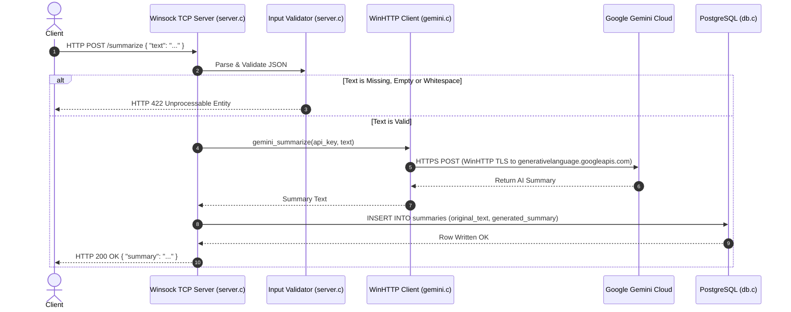

# AI Text Summarization REST API (C Language)

A high-performance, low-level **C Language REST API** for AI text summarization powered by **Google's hosted Gemini API** and **PostgreSQL**.

Built with native Windows Sockets (`Winsock2`) and native Windows HTTPS (`WinHTTP`), this service has **zero Python runtime dependencies** and compiles directly into native machine code.

---

## 1. Project Overview

The **AI Text Summarizer C API** is a lightweight, low-latency microservice written entirely in C. It listens on HTTP port `8000`, receives text payloads in JSON, validates input strings, dispatches HTTPS requests to Google's hosted Gemini foundation models (`gemini-3.1-flash-lite`), persists records in a PostgreSQL database table (`summaries`), and returns concise summaries formatted as JSON.

### Core Architectural Principles
- **100% Pure C (No Python)**: Eliminates Python interpreter overhead, running directly as native machine code.
- **Hosted Cloud AI (Zero Local Model Overhead)**: Communicates securely with Google Cloud's hosted Gemini infrastructure using the native Windows **WinHTTP API** over TLS/HTTPS.
- **Low-Level Socket Networking**: Employs Windows Sockets (`Winsock2` / `ws2_32.lib`) to manage raw TCP connections, HTTP/1.1 protocol parsing, and response serialization.
- **PostgreSQL Persistence**: Interacts with PostgreSQL using parameterized queries (`PQexecParams`) to prevent SQL injection vulnerabilities.
- **Manual Memory Safety**: Uses explicit dynamic allocation (`malloc` / `free`) with strict boundary checks to prevent memory leaks and buffer overflows.

---

## 2. Technology Stack

| Layer | Technology | Purpose |
| :--- | :--- | :--- |
| **Language** | ANSI C (C99 / C11) | Low-level systems programming language |
| **Networking** | Windows Sockets (`Winsock2` / `ws2_32.lib`) | Raw TCP socket listener & HTTP/1.1 server |
| **HTTPS / TLS** | Windows WinHTTP (`winhttp.lib`) | Secure HTTPS client calling Google Gemini Cloud |
| **Cloud AI** | Google Gemini Generative Language API | Hosted foundation models (`gemini-3.1-flash-lite`) |
| **Database** | PostgreSQL (`libpq` / `libpq-fe.h`) | Relational persistence store |
| **Build Tools** | GCC (MinGW-w64) / MSVC (`cl.exe`) | C compiler for Windows 11 |

---

## 3. Project Structure

```text
ai-text-summarizer/
│
├── server.c      # Main HTTP server, socket listener (port 8000), routing, JSON validation
├── gemini.h      # Header definition for Google Gemini HTTPS client
├── gemini.c      # Native WinHTTP client calling Google Generative Language API over TLS
├── db.h          # Header definition for PostgreSQL database operations
├── db.c          # PostgreSQL client integration using libpq
├── build.bat     # Automated Windows batch compiler script (GCC / MSVC)
├── Makefile      # Standard GNU Makefile for GCC / MinGW
├── .env          # API keys & database credentials (git ignored)
├── .env.example  # Environment variable template
├── .gitignore    # Excludes binaries (*.exe, *.obj) and secrets
└── README.md     # Complete project documentation
```

---

## 4. Architecture & Request Flow



---

## 5. API Endpoints

### 1. Health Check Endpoint
- **Method**: `GET /health`
- **Response** (`200 OK`):
  ```json
  {
    "status": "healthy",
    "version": "1.0.0",
    "language": "C"
  }
  ```

### 2. Main Summarization Endpoint
- **Method**: `POST /summarize`
- **Headers**: `Content-Type: application/json`
- **Request Body**:
  ```json
  {
    "text": "Artificial intelligence is transforming industries worldwide by automating repetitive tasks, uncovering deep data insights, and enabling new creative workflows."
  }
  ```
- **Response** (`200 OK`):
  ```json
  {
    "summary": "Artificial intelligence automates tasks, uncovers data insights, and streamlines creative workflows across global industries."
  }
  ```

### 3. Input Validation Rejection
If the client sends an empty string or whitespace-only text (`"   "`):
- **Response** (`422 Unprocessable Entity`):
  ```json
  {
    "detail": "The 'text' field cannot be empty or contain only whitespace."
  }
  ```

---

## 6. How to Compile and Run on Windows 11

### Step 1: Configure Environment Variables
Create your `.env` file from the template:
```cmd
copy .env.example .env
```

Open `.env` and configure your keys:
```ini
# Google Gemini API Key from https://aistudio.google.com/
GEMINI_API_KEY=AIzaSy...your_actual_key...

# PostgreSQL Connection String
DATABASE_URL=host=localhost port=5432 dbname=summarizer_db user=postgres password=postgres
```

### Step 2: Compile the Code
Run the included build script:
```cmd
build.bat
```

*(Or compile directly with GCC via MinGW)*:
```cmd
gcc -O2 -Wall server.c gemini.c db.c -o server.exe -lws2_32 -lwinhttp
```

*(Or compile with Microsoft Visual C++ `cl.exe`)*:
```cmd
cl /O2 /Fe:server.exe server.c gemini.c db.c ws2_32.lib winhttp.lib
```

### Step 3: Start the Server
```cmd
server.exe
```

Output:
```text
==============================================================
    AI TEXT SUMMARIZATION REST API - C LANGUAGE BACKEND
==============================================================
GEMINI_API_KEY: LOADED
DATABASE_URL:   DEFAULT
Listening on:   http://127.0.0.1:8000
==============================================================

Server successfully started! Waiting for HTTP requests...
```

---

## 7. How to Test the API

Open a PowerShell terminal and test using `Invoke-RestMethod` or `curl`:

```powershell
# 1. Health check
Invoke-RestMethod -Uri "http://127.0.0.1:8000/health" -Method Get

# 2. Valid summarization request
Invoke-RestMethod -Uri "http://127.0.0.1:8000/summarize" -Method Post -ContentType "application/json" -Body '{"text": "SpaceX designs, manufactures and launches advanced rockets to revolutionize space travel."}'

# 3. Test validation rejection (Empty text)
Invoke-RestMethod -Uri "http://127.0.0.1:8000/summarize" -Method Post -ContentType "application/json" -Body '{"text": "   "}'
```

---

## 8. Database Table Schema (PostgreSQL)

The table is defined as:
```sql
CREATE TABLE IF NOT EXISTS summaries (
    id SERIAL PRIMARY KEY,
    original_text TEXT NOT NULL,
    generated_summary TEXT NOT NULL,
    created_at TIMESTAMP WITH TIME ZONE DEFAULT NOW()
);
```

---

## 9. What Was Learned

- **Raw Socket Web Architecture**: Implementing HTTP/1.1 from scratch using Windows Sockets (`Winsock2`), managing TCP handshakes, and parsing HTTP request headers.
- **Native HTTPS in C without External Libs**: Utilizing Windows **WinHTTP** to securely establish TLS/HTTPS handshakes with Google's REST endpoints, send authentication headers, and stream response bodies.
- **Memory Safety & String Manipulation in C**: Explicitly allocating buffers, escaping JSON characters to avoid injection errors, and handling pointer math without memory corruption.
- **Relational Integration with libpq**: Using PostgreSQL's native C client library with parameterized SQL statements (`PQexecParams`) for secure data persistence.
